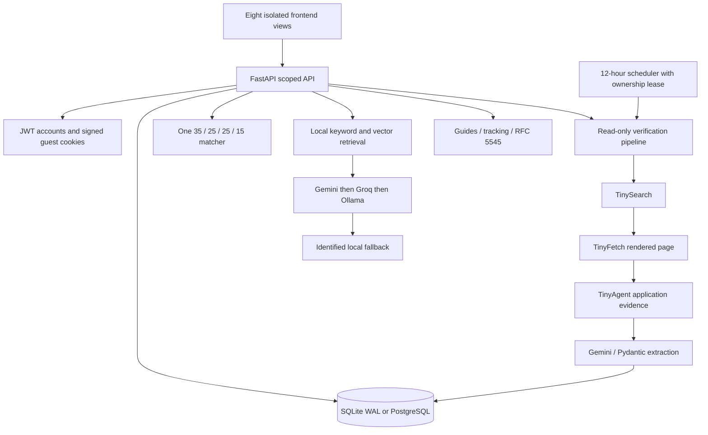

# IRIS onE architecture

The existing FastAPI and vanilla JavaScript architecture is retained. A local demonstration needs no frontend framework or external database.

`switchView` shows one view at a time; the application dialog has native focus management. Cream/nav/blue identity and navigation remain intact. Loading, empty data, errors, streaming and expired auth have explicit handling. Initial profile loading establishes a cookie before parallel workspace calls.

Profiles, saves and applications belong to the authenticated user or an unpredictable signed guest ID. Older save/application/chat APIs use the same workspace services. Production admin diagnostics require a separate server-side key. Public health omits paths and user counts.

The shared matcher totals 100 points without an artificial 65% minimum. Conditions are passed, failed or unknown. Cached rules support “likely eligible”; “confirmed eligible” additionally requires recent actual verification and all recorded conditions met by the supplied profile. Neither substitutes for document review by the program provider.

Verification is shared catalog data; matching is personal. TinyFish adapters make bounded calls without implicit billed retries. Pydantic validates extraction; destinations must be public and match the inspected application domain. Omitted fields preserve known criteria/deadlines. Closed/past-deadline actions cannot become verified. Freshness is derived on reads even with the scheduler stopped.

The assistant reads stored records. Retrieved text stays in a user-data payload outside system rules. Cloud assistant context excludes raw resume text, email and vectors. Named archived programs can be explained as historical records. General recommendations exclude expired deadlines. Local answers cite stored dates, rules and portals; missing facts remain missing.

PDF/DOCX/TXT parsing validates content and size, bounds pages and decompressed size, and rejects corrupt or unreadable documents. Optional Gemini extraction uses the shared client and reports the model. Local parsing supplies supported facts only. Completeness comes from actual profile fields.

SQLite uses WAL, foreign keys and a busy timeout. The PostgreSQL adapter preserves SQL contracts with optional pgvector. Migrations are additive. Established PostgreSQL failure never redirects writes; production also forbids startup fallback. Scheduler ownership combines an OS lock with a renewable database lease.

Small shared modules centralize runtime policy (`runtime_config.py`), request/URL guards (`security.py`), Gemini requests (`providers.py`) and redacted process-local evidence (`diagnostics.py`). Duplicated unsafe legacy implementations are replaced by compatibility wrappers.
